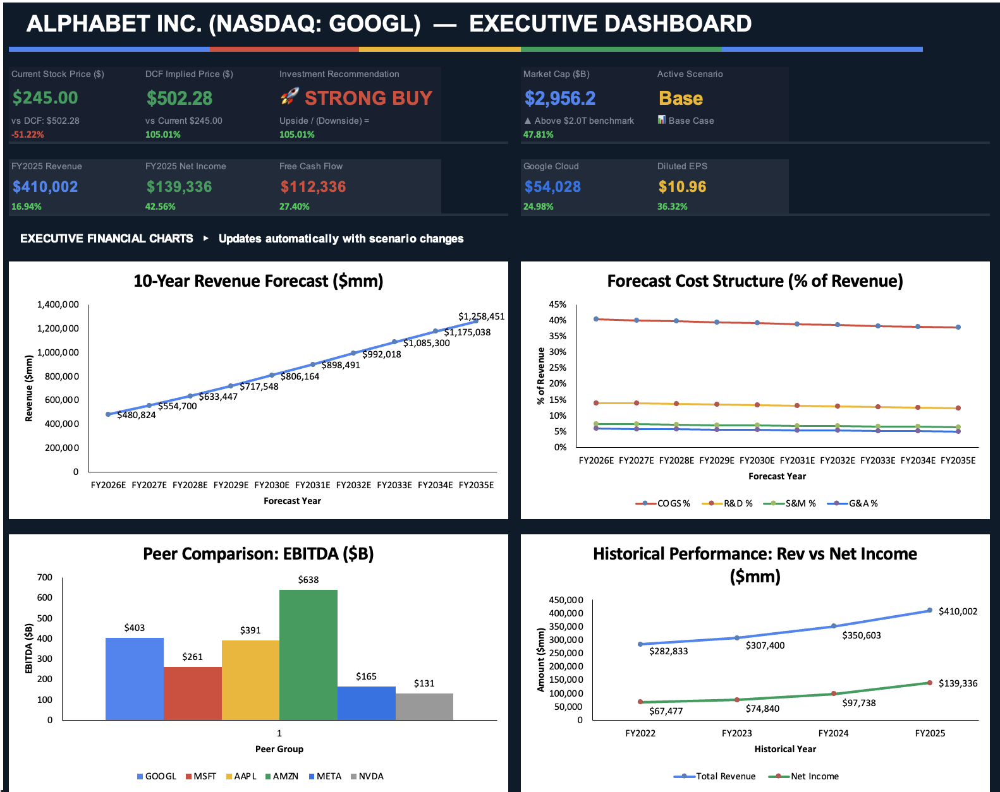

# Alphabet (GOOGL): SQL-Powered 3-Statement Model and 10-Year DCF

**Built:** March 2026 · **Data:** SEC EDGAR 10-K filings, FY2022–FY2025

## Files

| File | Contents |
|---|---|
| [Alphabet_GOOGL_Model.xlsx](Alphabet_GOOGL_Model.xlsx) | 14-sheet workbook: assumptions, the three statements, segment revenue, trend analysis, KPI engine, 10-year forecast, DCF, comparables, executive summary, SQL library, dashboard |
| [Alphabet_GOOGL_Summary.pdf](Alphabet_GOOGL_Summary.pdf) | Three-page written summary: thesis, WACC build-up, scenarios, forecast tables |
| [queries.sql](queries.sql) | The 10 SQL queries behind the model: margins, growth and CAGR, ROE/ROA, liquidity, FCF, segment mix, the projection engine, the sensitivity grid |

## Method

1. Loaded four years of income statement, balance sheet and cash flow data into SQL tables.
2. Used the queries to compute margins, returns, liquidity and segment mix. Those outputs feed the forecast drivers.
3. Built five revenue segments (Search, YouTube, Cloud, Subscriptions & Devices, Other Bets) and forecast each one out 10 years.
4. Discounted unlevered free cash flow at a CAPM WACC of 9.85%:
   - risk-free rate 4.20%
   - equity risk premium 5.50%
   - beta 1.05
   - 98% equity / 2% debt
5. Ran bear, base and bull scenarios. Each one scales revenue, operating margin and terminal growth.

## Results

| | Bear | Base | Bull |
|---|---|---|---|
| Terminal growth | 2.5% | 3.5% | 4.5% |
| Implied price per share | $238 | $502 | $643 |

The share price used for comparison was $245.00 at the time the model was built. A WACC × terminal-growth grid shows how sensitive the base case is to both inputs.

## What I learned

The gap between the bear and bull cases is wider than the current share price. That made me argue for the range of values and the assumptions behind them, rather than defend one target number.
