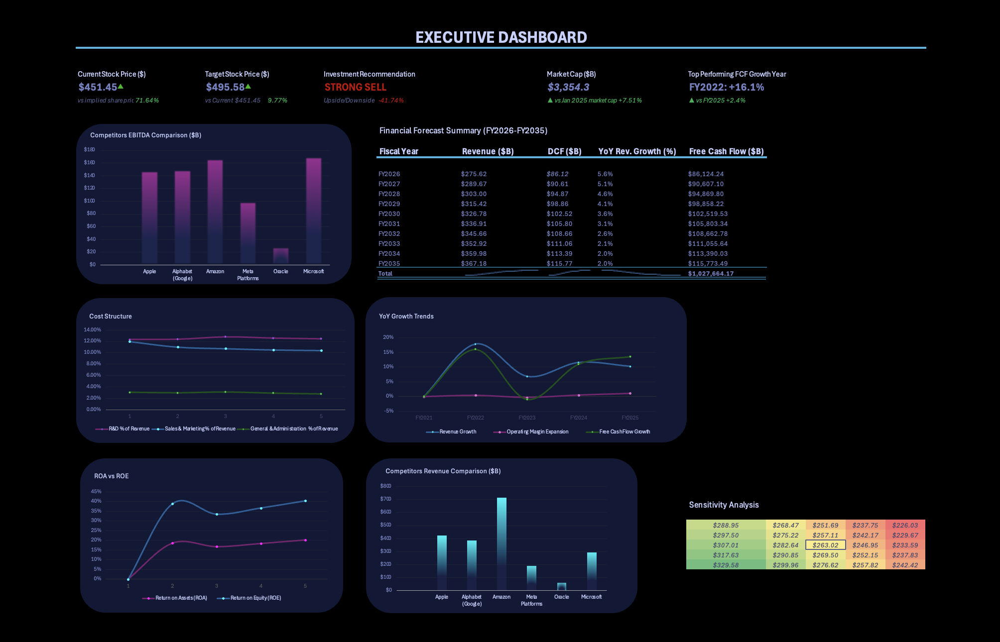

# Microsoft (MSFT): Integrated 3-Statement Model and DCF

**Built:** January 2026 · **Data:** SEC EDGAR 10-K filings, FY2021–FY2025

## Files

| File | Contents |
|---|---|
| [Microsoft_MSFT_Model.xlsx](Microsoft_MSFT_Model.xlsx) | 11-sheet workbook: assumptions, the three statements, KPI engine, trend analysis, 10-year forecast, DCF, sensitivity analysis, comparable companies, dashboard |
| [Microsoft_MSFT_Summary.pdf](Microsoft_MSFT_Summary.pdf) | Two-page written summary: thesis, valuation parameters, scenarios, forecast tables |

## Method

1. **Rebuilt five years of statements from the 10-Ks.** The cash flow statement needed reconciliation adjustments for FX effects and rounding in the published figures. These are documented in cell comments.
2. **Forecast revenue with cloud and AI segment build-ups through FY2035.** Bear, base and bull scenarios use 0.7×, 1.0× and 1.3× growth multipliers.
3. **Valued the company three ways:**
   - DCF at an 8.5% WACC (CAPM, beta 0.95, risk-free rate 4.2%) and 3.0% terminal growth
   - implied P/E against peers
   - implied EV/EBITDA against peers
4. **Peer set:** Apple, Alphabet, Amazon, Meta and Oracle.

## Results

| | Bear | Base | Bull |
|---|---|---|---|
| FY2035 revenue | $399.6B | $570.9B | $742.1B |
| DCF price per share | $264 | $377 | $490 |

Peer multiples imply $462 (P/E) and $496 (EV/EBITDA), both above the DCF base case. Most of that gap comes from how quickly AI revenue is assumed to grow.
