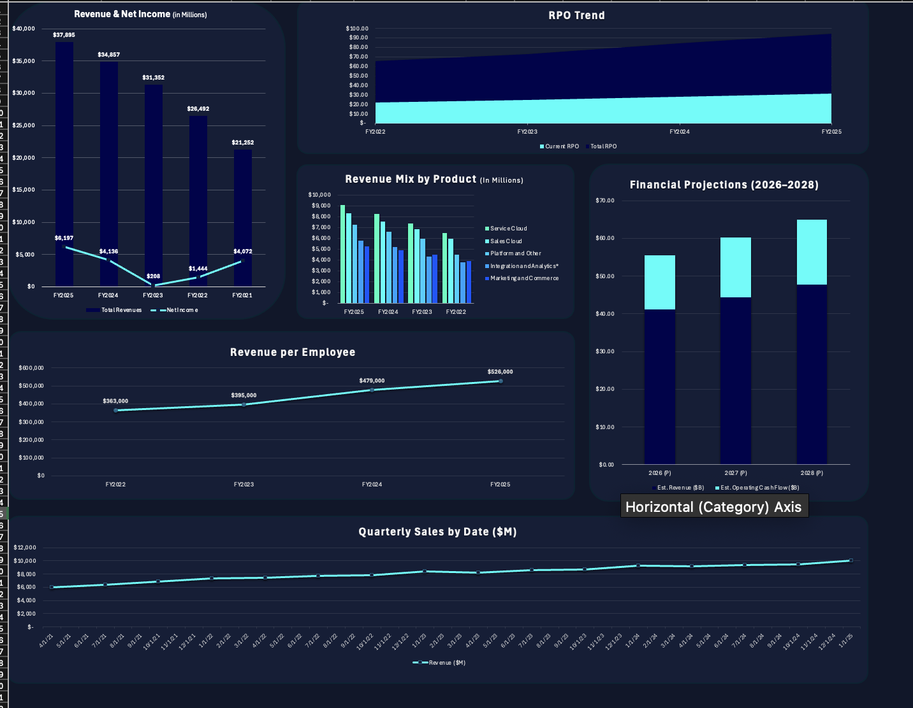

# Salesforce (CRM): Financial Teardown and RPO-Anchored Forecast

**Built:** January 2026 · **Data:** SEC EDGAR 10-K filings and investor-relations supplements, FY2021–FY2025

## Files

| File | Contents |
|---|---|
| [Salesforce_CRM_Model.xlsx](Salesforce_CRM_Model.xlsx) | 12-sheet workbook: the three statements, revenue streams, projections, comprehensive income, RPO, operating efficiency, risk analysis, quarterly sales, dashboard |
| [Salesforce_CRM_Summary.pdf](Salesforce_CRM_Summary.pdf) | Two-page written summary: thesis, forecast table, segment and geographic teardown |

## What the model covers

- **Segments:**
  - Five product clouds: Service, Sales, Platform, Integration & Analytics, Marketing & Commerce
  - Geographic revenue mix
- **Margin turnaround:** GAAP operating margin rose from 2.1% (FY2022) to 19.0% (FY2025) after the restructuring.
- **Revenue visibility:** total RPO of $63.4B, of which $31.0B is current RPO. The forecast uses it as an anchor.
- **Productivity:** revenue per employee rose from $363K to $526K over FY2022–FY2025.

## Forecast

| ($B) | FY2025A | FY2026P | FY2027P | FY2028P |
|---|---|---|---|---|
| Revenue | 37.90 | 41.12 | 44.41 | 47.74 |
| Free cash flow | 12.14 | 13.39 | 14.66 | 15.98 |
