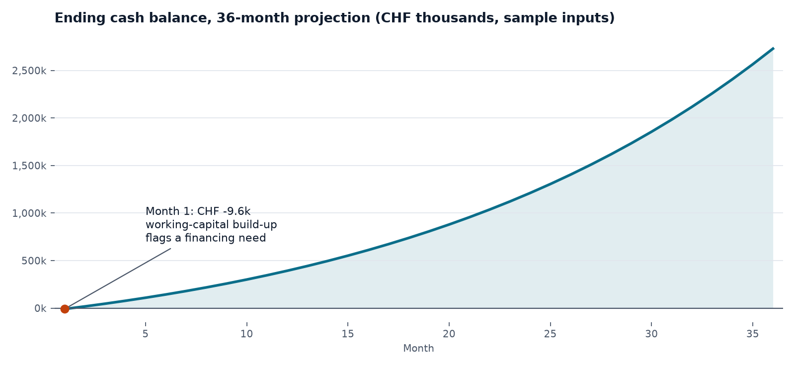

# Manufacturing Financial Diagnostic System (client deliverable)

**Built:** March 2026, for a consulting client in Swiss manufacturing · **Currency:** Swiss francs by default, with a switch for USD, EUR and GBP · **Type:** input-ready Excel model

## The brief

The client did not want another set of accounting statements; their accountant already produces those. They wanted a tool that **catches financial warning signals early** and supports decisions:

- Does the business need financing?
- Is working capital tying up too much cash?
- Is the capital structure out of balance?

They also asked for:

- benchmarks that are transparent and easy to update
- clear explanations
- charts that a non-finance owner can read at a glance

## What the model does

1. **Inputs (one sheet).** The owner enters:
   - monthly revenue and growth
   - seven cost lines
   - collection, inventory and payment days (DSO, DIO, DPO)
   - capital spending and equipment life
   - debt, interest rate and tax rate
2. **Statements (36 months).** The model builds a linked income statement, balance sheet and cash flow. The balance sheet balances, and its cash ties to the cash flow statement every month.
3. **Parameters sheet.**
   - **Benchmarks:** target gross margin, EBITDA margin, net margin, current ratio, inventory turnover and debt-to-equity, each with a source label, so they can be updated for a specific sub-sector.
   - **Reporting currency:** a dropdown (CHF, USD, EUR or GBP) relabels every amount in the workbook.
4. **KPI Engine.** Compares month-1 results with all six benchmarks and labels every indicator **Healthy** or **Critical**.
5. **Dashboard & Insights.** Headline cards, six charts and four automated decision signals:

| Signal | Rule |
|---|---|
| Financing need | Any month with negative projected cash → **CRITICAL**: external financing or a credit line is required |
| Working capital | Cash conversion cycle (DSO + DIO − DPO) above 45 days → **WARNING**, with levers to pull |
| Short-term liquidity | Current ratio below target → **CRITICAL** |
| Solvency | Debt-to-equity above target → **WARNING** |

## Sample run

The workbook ships with sample inputs:

- CHF 100k monthly revenue growing 5% a month
- 30-day collection, inventory and payment cycles
- CHF 50k of debt

| Output | Result |
|---|---|
| 36-month revenue | CHF 9.58M |
| Average EBITDA margin | 45% |
| Month-1 cash | **CHF −9.6k → financing need flagged** |
| Month-36 cash | CHF 2.73M |
| Debt-to-equity | Above the 1.0x target → leverage warning |

The business is profitable from month 1, yet cash dips below zero because receivables and inventory build up before customers pay. Spotting that kind of signal is what the client hired the tool for.

## File

[Manufacturing_Financial_Diagnostic_System.xlsx](Manufacturing_Financial_Diagnostic_System.xlsx) contains sample inputs only, with no client data. Open it in Excel; it recalculates when it opens.
